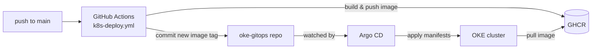
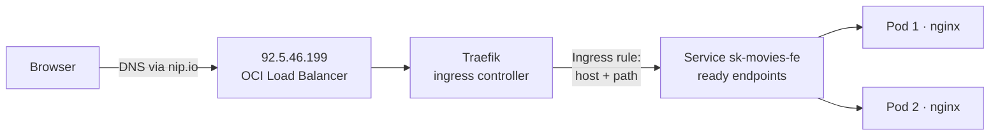

https://github.com/neo4j-graph-examples/recommendations
https://github.com/iftahro/Neo4NBA/tree/master

## Edge caching / CDN

Static build output is served from the edge, not a single origin: Vercel replicates it across
its global edge network, and GitHub Pages does the same via its own CDN (the second deploy
target this app builds for).

Where to verify in code/config:
- `vercel.json` — `headers` rule gives content-hashed `_app/immutable/*` assets a 1-year
  immutable cache (`Cache-Control: public, max-age=31536000, immutable`); the HTML shell stays
  `must-revalidate` since it's what points at the current hashed filenames.
- `svelte.config.js` — `adapter-static` output is what both Vercel and GitHub Pages serve.

To verify live: `curl -sI https://sk-movies-fe.vercel.app/` — the `X-Vercel-Id` response header
(e.g. `fra1::...`) shows which edge region actually answered the request.

## Kubernetes deployment (OKE + Argo CD)

Besides Vercel / GitHub Pages, the app also runs as a container on an Oracle Cloud (OKE) Kubernetes cluster, deployed via GitOps.

- Live: http://movies.92.5.46.199.nip.io
- Manifests: [oke-gitops/sk-movies-fe](https://github.com/SergeyKharkovshchenko/oke-gitops/tree/main/sk-movies-fe)
- Pipeline: [.github/workflows/k8s-deploy.yml](.github/workflows/k8s-deploy.yml)
- Image: `ghcr.io/sergeykharkovshchenko/sk-movies-fe` (GitHub Container Registry)

### Delivery pipeline

1. A push to `main` triggers `k8s-deploy.yml` on a GitHub-hosted `ubuntu-latest` runner.
2. It builds the static SvelteKit app (`BASE_PATH=''`), packs it into an `nginx:1.27-alpine` image (amd64 + arm64) and pushes it to GHCR tagged `latest` and `<commit-sha>`.
3. It rewrites the `image:` line in `oke-gitops/sk-movies-fe/deployment.yaml` to the new SHA and pushes.
4. Argo CD detects the change in `oke-gitops` and syncs the cluster to match Git.
5. The kubelet on the target nodes pulls the new image from GHCR; the Deployment rolls it out pod by pod (`maxUnavailable: 0`, so no downtime).

### Argo CD resource tree

| Resource | Name | Runs where | Responsible for | Created by |
|---|---|---|---|---|
| Application (Argo CD) | `sk-movies-fe` | namespace `argocd` | Watches `oke-gitops/sk-movies-fe/` and keeps the cluster in sync with Git | Created once manually |
| Service | `sk-movies-fe` | namespace `default`, ClusterIP, port 80 | Stable in-cluster name/address for the pods; its endpoints list only *ready* pods | Argo CD (from `deployment.yaml`) |
| Ingress | `sk-movies-fe` | Traefik, host `movies.92.5.46.199.nip.io` | Routes external HTTP traffic for this host to the Service | Argo CD (from `deployment.yaml`) |
| Deployment | `sk-movies-fe` | namespace `default` | Desired state: image, 2 replicas, RollingUpdate, readiness/liveness probes, spread across nodes | Argo CD (from `deployment.yaml`) |
| ReplicaSet | `sk-movies-fe-<hash>` | namespace `default` | Keeps exactly 2 pods of the current revision running. A new ReplicaSet is created per revision; old ones stay with 0 pods for rollback (`kubectl rollout undo`) | Deployment controller |
| Pod ×2 | `sk-movies-fe-<hash>-<id>` | OKE worker nodes | nginx container serving the static build on port 80 | ReplicaSet controller → kube-scheduler picks a node → kubelet pulls the image and starts the container |

### Request path: browser → pod

1. **DNS** – `movies.92.5.46.199.nip.io` is a [nip.io](https://nip.io) wildcard name: it simply resolves to the IP embedded in it, `92.5.46.199`. No DNS records to manage.
2. **Load balancer** – the public IP belongs to the OCI Load Balancer that OKE provisioned for Traefik's `LoadBalancer` Service. It forwards port 80 to the Traefik pods on the worker nodes.
3. **Traefik** – the ingress controller reads the `Host` header and matches the `sk-movies-fe` Ingress rule (`movies.92.5.46.199.nip.io`, path `/`). The same IP also serves Argo CD at `argocd.92.5.46.199.nip.io` – only the host name differs.
4. **Service → Pod** – Traefik looks up the endpoints of the `sk-movies-fe` Service and sends the request to one of the *ready* pod IPs. A pod failing its readiness probe is removed from the endpoints automatically, so traffic only reaches healthy pods.
5. **Pod** – nginx returns `index.html` and the content-hashed assets of the static SvelteKit build. From there the app runs in the browser; API calls go directly from the browser to `VITE_API_URL`, not through the cluster.
